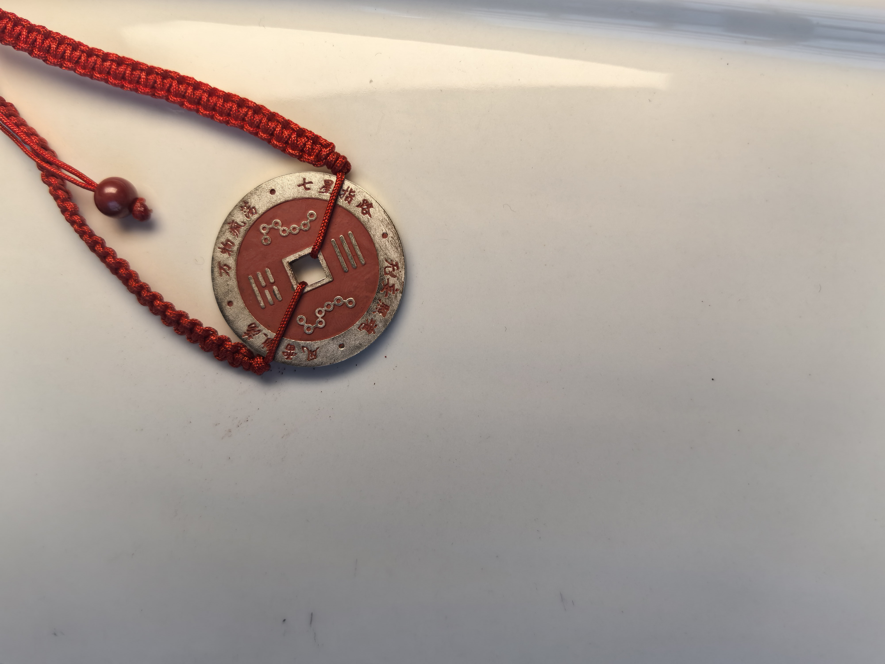
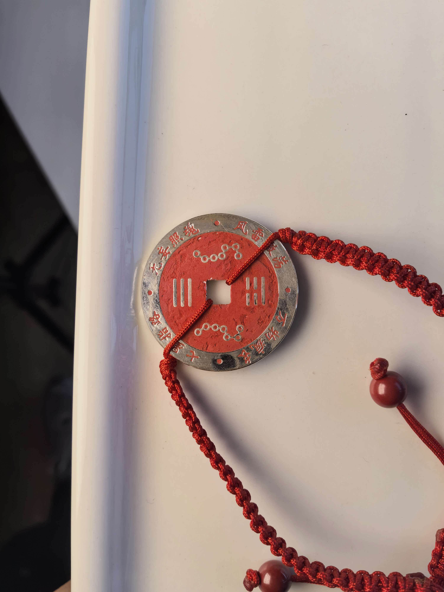
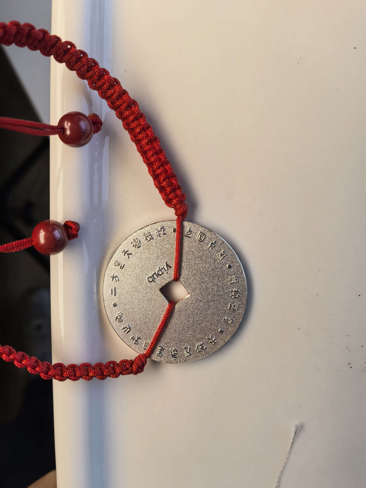

# 天雷无妄花钱初始发布登记

- **日期**：2026-10-30
- **分类**：硬件信物 / 发行登记
- **核心象义**：天雷无妄, 花钱, 版本一, 版本二, 初始持有

---

## 导读

【天雷无妄】花钱分两批落盘，合计十一枚。本篇登记两版形制的正反面，以及初始持有人，作为后续流转的底账。

版本一共六枚，天道逐枚标记。版本二共五枚，正反标记成对落在同一枚上。

---

## 一、形制影像

### 版本一

<figure>

<figcaption>版本一 · 正面</figcaption>
</figure>
<figure>

<figcaption>版本一 · 反面</figcaption>
</figure>

### 版本二

<figure>

<figcaption>版本二 · 正面</figcaption>
</figure>
<figure>

<figcaption>版本二 · 反面</figcaption>
</figure>

---

## 二、版本一持有登记

第一批六枚。

| 天道标记 | 所有者 | 备注 |
| --- | --- | --- |
| 中孚 ䷼ | 察水观月 | |
| 貔 | 阿巴老师 | |
| 颐卦 ䷚ | 宫主 | |
| 震 ䷲ | 天一阁古筝演奏者 | |
| 大畜卦 ䷙ | 待寻 | 暂时保留在神器铸造师手上 |
| 豫卦 ䷏ | 待寻 | 暂时保留在神器铸造师手上 |

---

## 三、版本二持有登记

第二批五枚。斜线两侧分别为正面标记与反面标记。本批目前只登记了一位持有人。

| 正面标记 | 反面标记 | 所有者 | 备注 |
| --- | --- | --- | --- |
| 莲 | 难近母种子 | 待寻 | 暂时保留在神器铸造师手上 |
| 蹇 ䷦ | 金星 | 待寻 | 暂时保留在神器铸造师手上 |
| 鲲 | 明夷 ䷣ | 李炜 | |
| 困 ䷮ | 大过 ䷛ | 待寻 | 暂时保留在神器铸造师手上 |
| 金刚种子字 | 渐 ䷴ | 甜筒 | |

---

## 四、花钱佩戴与养护宜忌

本花钱以 999 纯银为胎，凹槽手工填嵌天然朱砂。日常佩戴与养护时，建议参考以下几项事宜：

### 【 宜 】

1. **宜·思绪杂乱时佩戴静心**：花钱本就取“直面现实、扫除虚妄”之意。日常若思绪纷乱、心神不宁，适宜贴身佩戴或手抚边缘，借银钱沉静的质感帮助自己收敛杂念，回到当下的平静。

2. **宜·低调内敛，保持谦和**：器物是自修自省的提示，重在内心笃实，不宜对外夸示炫耀。藏锋守拙，平和待人。

3. **宜·贴身温养**：纯银导热快，朱砂质温。贴身佩戴（如胸前或手腕）有助于气血温润、日常御寒。

4. **宜·顺应食欲，温和进食**：初戴若有身体转暖、肠胃活跃、明显饥饿之感，是体表受寒散去、消化功能恢复的自然反应。顺应身体需要，适量进食温软清淡的热食即可，无需刻意克制。

5. **宜·指腹轻抚纯银外缘**：闲暇盘抚时，用洁净的手指或掌心摩挲外圈银边即可，日久会自然形成温润的纯银包浆。

### 【 忌 】

1. **忌·炫耀夸饰**：勿将信物当作谈资或标榜特殊的道具，避免引来不必要的口舌与是非。

2. **忌·不解其意而盲从佩戴**：花钱刻有“天秤左右是你和世界，上方是天道雷池，直面真实，锻打无妄”。佩戴者应当知晓其敬畏因果、信守承诺之本意，不宜视作盲目求财祈福的世俗饰品。

3. **忌·体内有实火者佩戴**：朱砂性偏温燥，若身体正处于上火、咽喉肿痛、牙龈发炎、口舌生疮或高热便秘等实热状态，应暂停贴身佩戴，待火气消退、体质平稳后再戴。

4. **忌·用布料擦拭字槽**：字槽内嵌天然朱砂颗粒，严禁用棉布、擦银布、毛巾用力擦拭字口。布匹纤维容易挂扯导致朱砂松脱剥落。若有积灰，可用极软的小毛刷轻轻掸去。

5. **忌·化学品浸泡与超声波清洗**：避免接触洗银水、强酸强碱、香水与洗涤剂，切勿使用超声波清洗机，以免损伤银质和朱砂结构。